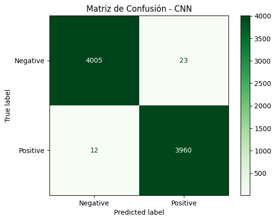
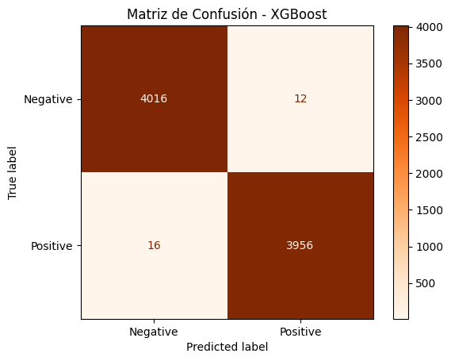
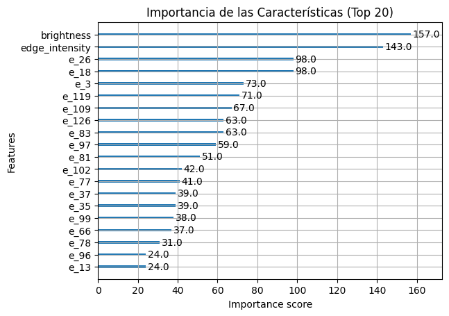
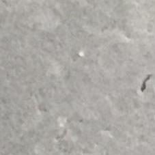
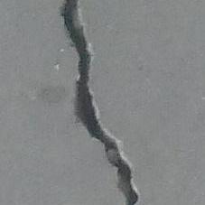

# Clasificación de grietas en hormigón con CNN y XGBoost

Este proyecto usa una red neuronal convolucional (CNN) para extraer características de imágenes y entrena después un clasificador XGBoost con esas características y dos variables adicionales calculadas a partir de cada imagen.

## Flujo de trabajo

1. Redimensionar y normalizar imágenes de hormigón con y sin grietas.
2. Entrenar una CNN para clasificación binaria.
3. Extraer vectores de características de 128 dimensiones de la capa penúltima de la CNN.
4. Añadir el brillo medio y la intensidad de los bordes.
5. Entrenar y comparar el clasificador XGBoost.

El notebook registra una exactitud del **99,56 %** para la CNN y del **99,65 %** para XGBoost con las características combinadas. Son resultados de la partición de validación 80/20 del notebook, no de un conjunto de prueba independiente; no deben interpretarse como una medida del rendimiento en producción.

## Resultados







## Estructura del repositorio

- `notebooks/cnn_boosting_crack_classification.ipynb`: experimento y evaluación completos.
- `images/`: gráficos extraídos de las salidas guardadas del notebook.
- `data/sample/`: muestra de 10 imágenes por clase para mostrar el formato de los datos.
- `data/README.md`: procedencia, licencia y estructura esperada de los datos.
- `requirements.txt`: dependencias de Python.

## Datos

El repositorio incluye una muestra de **20 imágenes** (10 con grietas y 10 sin grietas), seleccionadas del conjunto [Concrete Crack Images for Classification, versión 2](https://data.mendeley.com/datasets/5y9wdsg2zt/2), de Çağlar Fırat Özgenel. Las imágenes se han copiado sin alterar; la selección de esta muestra es la única modificación. La licencia y la atribución de la muestra se detallan en [`data/sample/README.md`](data/sample/README.md).

**Imagen de prueba Negativa:**



**Imagen de prueba Positiva:**



El conjunto completo (40.000 imágenes) no se incluye. Si tienes una copia autorizada, colócala en esta ubicación para ejecutar el entrenamiento:

```text
data/cemento_dataset/
├── Negative/
└── Positive/
```

El notebook utiliza una partición 80/20 con semilla 42. Necesita el conjunto completo para entrenar la CNN y volver a generar los embeddings y las características tabulares. La carpeta del conjunto completo está excluida de Git; la muestra pequeña sí forma parte del repositorio.

## Ejecución

Utiliza un entorno de Python compatible con la versión de TensorFlow instalada. Desde la raíz del repositorio:

```bash
python -m venv .venv
source .venv/bin/activate
python -m pip install -r requirements.txt
jupyter lab notebooks/cnn_boosting_crack_classification.ipynb
```

En Windows PowerShell, activa el entorno con `.venv\Scripts\Activate.ps1` en lugar del comando `source`.

Ejecuta las celdas del notebook en orden.

## Licencias

El código original del proyecto se distribuye bajo la [licencia MIT](LICENSE). La licencia MIT no cubre las imágenes de terceros: la muestra del conjunto de datos se distribuye bajo [Creative Commons Atribución 4.0 Internacional (CC BY 4.0)](https://creativecommons.org/licenses/by/4.0/), con la atribución indicada en [`data/sample/README.md`](data/sample/README.md).